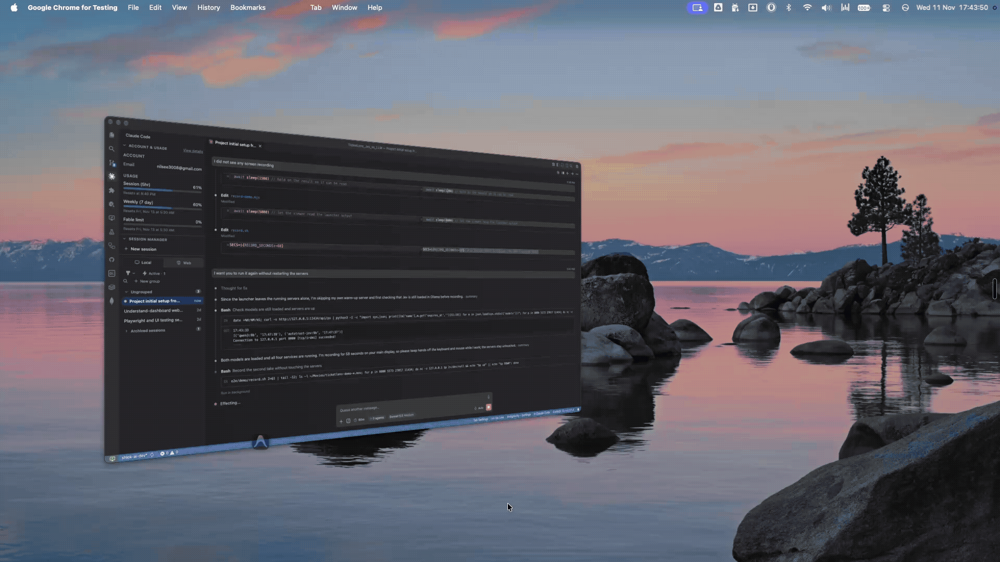
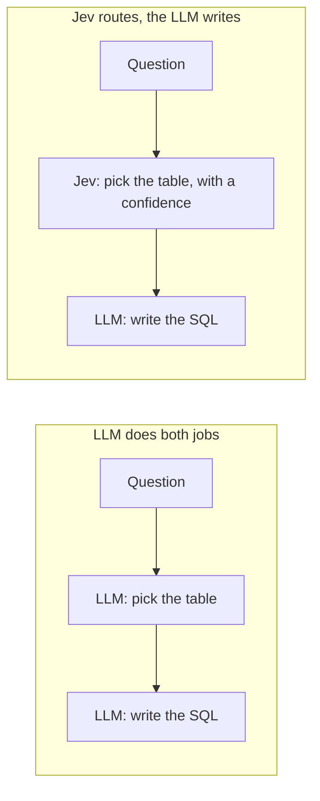

# TicketLens: Jev vs an LLM


A local app that puts **Jev**, a decision-only AI model, next to a general-purpose **LLM** on the same job, and measures what each one does well.



[Full video with controls (58 s, MP4)](e2e/demo/ticketlens-demo.mp4). In this recording, three new support tickets (easy, medium, complex) are typed in and both models classify each one live. Jev answered in about 1.5 to 2.0 s and the LLM in about 2.7 to 2.9 s.

## What this repo is

TicketLens is a single-user web app. It takes customer-support tickets from a fictional Indian e-commerce marketplace, ShopKart, and asks Jev and an LLM to classify each one: category, subcategory, priority, sentiment and whether to escalate. You see both answers side by side, field by field.

- Create tickets by hand or import them from CSV, then search, filter, edit and export them.
- Run Jev, the LLM or both on one ticket or on many.
- Choose or edit each ticket's final classification yourself. No winner is ever picked automatically.
- Review every AI attempt with its tokens, estimated cost, and the exact request and response.
- Measure accuracy against 100 labelled sample tickets, and speed, on the Overview page.

It uses synthetic data only, and it runs entirely on your computer.

## The purpose of this repository

To test one idea: **in an AI agent, the step that decides where a request goes does not need a large language model.** A decision-only model can do that step, and the LLM is kept for the step that needs writing. TicketLens runs both on identical tickets, so the difference in answers, speed and reliability is measured, not assumed.

## What is Jev?

Jev is a **decision-only** model from TypeSafe AI, part of a family called "System One" models. You give it a question and a fixed list of options. It answers with one of them and a confidence, or with a probability for a yes/no question. It never writes prose. See the overviews by [DataCamp](https://www.datacamp.com/blog/system-one-models-jev) and [LangChain](https://www.langchain.com/blog/building-a-harness-with-jev).

**Which Jev runs here:** [AutoTrust JEV-9B](https://huggingface.co/autotrust/JEV-9B), an open-weights model distilled from TypeSafe's Jev and run locally through Ollama. AutoTrust states it is not affiliated with TypeSafe, so it is labelled "AutoTrust JEV" throughout the app. An adapter for TypeSafe's hosted Jev is built into the code but not switched on. The LLM side runs `qwen3:8b`, also through Ollama.

## Why use Jev for routing

Many AI agents use an LLM for two different jobs at once. Take an agent with three data tables: sales, inventory and customer ageing. A user asks "What were total sales in 2026?" The LLM first has to decide which table the question belongs to, and then write the SQL for it.

The first job is a classification. It does not need a model that can write. Jev can take it, and the LLM only does the writing:



*An illustration of the pattern. This repository tests the routing step on support tickets, not text-to-SQL.*

Why Jev suits the routing step:

- **It is faster.** On the same tickets, on the same computer, Jev answered in a median of 1.43 s and the LLM in 2.74 s (10 tickets, `reports/test-runs/`). In the demo recording it was about twice as fast on every ticket.
- **Its answers are constrained.** It can only choose from the list you give it, so a router never returns a label that does not exist. In the 100-ticket run, Jev gave no invalid answers, while the LLM twice paired a subcategory with the wrong category.
- **It reports a confidence.** Each answer comes with a probability, shown in the app as "% conf.". A router can send low-confidence cases to the LLM or to a person.
- **It is a small model for a small job.** The idea behind the savings is that a compact model does the cheap step and the large model is used only where writing is needed. This repo measures time, not money: both models run locally, so there is no per-call charge.

On the 100 labelled tickets the two were close on accuracy (category 89% for Jev and 86% for the LLM; preliminary). The case for Jev is that it does the routing job as well, faster and in a form that is easy to check.

## Where it can be used

Anywhere software has to choose from a known set of options before something else happens. These are examples of the pattern:

- **Agent routing:** pick which tool, data source or specialist agent should handle a request, as in the SQL example above.
- **Support-ticket triage:** category, priority and sentiment, which is what this repo does.
- **Intent detection:** decide what a user wants before a chatbot answers.
- **Yes/no decisions:** should this ticket be escalated? Is this order eligible for a refund?
- **Guardrail gates:** is a request allowed, or does it need review, before it reaches a larger model?
- **Workflow branching:** send a case to the right queue, team or approval path.

## How it was built

The whole project was built with AI, without the owner touching a single code file:

- **Planning:** ChatGPT and Gemini.
- **Development:** Claude Code, from scratch.
- **Testing:** Claude Code with a Playwright MCP server, automating the browser tests and the testing process.

Work that would normally take a month or two took about 7 to 8 hours (the owner's estimate). AI did not replace the thinking: it removed the weeks of typing. The takeaway is to learn to work with AI and master it before it masters you.

## Technologies

| Area | What is used |
|---|---|
| Frontend | React 19, TypeScript, Vite, Tailwind CSS 4, shadcn/ui (Radix), TanStack Query, React Router, React Hook Form with Zod, Recharts |
| Backend | Python 3.13, FastAPI, Pydantic, Uvicorn, PyMongo, httpx |
| Data | MongoDB Community Edition, running on your computer only |
| Models | AutoTrust JEV-9B (Jev side) and `qwen3:8b` (LLM side), served by Ollama. Hosted TypeSafe Jev is built into the adapter layer but not switched on, and another LLM provider can be added through the same contract. |
| Testing | pytest, ruff, ESLint, Playwright (browser and visual tests, scripted demo recording) |
| Upkeep | Dependabot for weekly dependency updates |

## Run it locally

You need Python 3.13, Node 22.12 or newer, MongoDB Community Edition, and [Ollama](https://ollama.com/download) with `autotrust-jev:9b` and `qwen3:8b` pulled. No Docker, no API keys.

**On a Mac, double-click `start-ticketlens.command`.** It starts MongoDB, Ollama, the backend and the frontend, skips any that are already running, and opens http://localhost:5173. Or, from the repository root, by hand:

```bash
cd backend && python3 -m venv .venv && .venv/bin/pip install -r requirements.txt
.venv/bin/uvicorn app.main:app --host 127.0.0.1 --port 8000    # backend
cd ../frontend && npm install && npm run dev                     # frontend, in a second terminal
```

The first run needs the one-time setup in [SETUP.md](SETUP.md): starting MongoDB, and choosing the local models in `backend/.env`. SETUP.md also has the full steps, how to use the app, troubleshooting and a checklist to confirm everything works. It is a local, single-user demo with no login, so do not deploy it publicly.

For the design and status of the project, start with [.context/PROGRESS.md](.context/PROGRESS.md).
